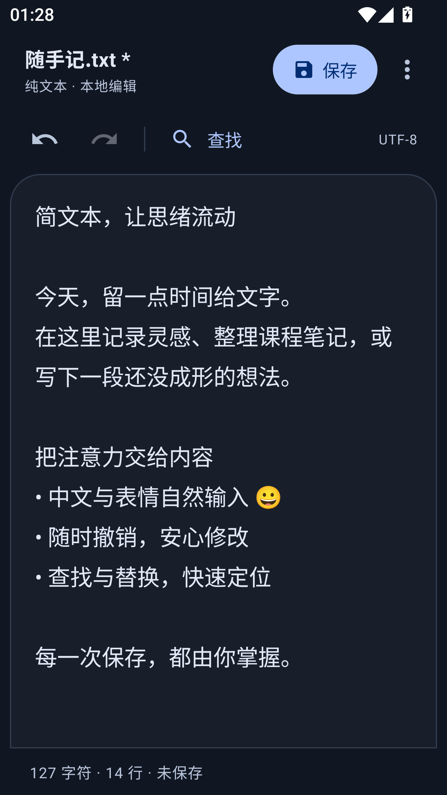

# TXTDesign · 双端文本编辑器

[](https://github.com/mikubob/TXTDesign/actions/workflows/build.yml)

离线、中文界面的 UTF-8 纯文本编辑器，支持 Android 和 Windows。两端共享纯 Java 编辑核心：自行实现的间隙缓冲区、KMP 查找，以及最近 100 条操作的撤销与重做。

## 下载与安装

从 **[GitHub Releases](https://github.com/mikubob/TXTDesign/releases/latest)** 下载，无需下载整个源码仓库。

| 文件 | 用途 |
| --- | --- |
| `TXTDesign-android.apk` | Android 8.0 及以上，下载后允许当前来源安装应用 |
| `TXTDesign-1.3.0.exe` | Windows x64 安装器，自带 Temurin Java 21 运行时，按当前用户安装 |
| `txteditor-windows.jar` | 已安装桌面 Java 8+ 的用户可运行 `java -jar txteditor-windows.jar` |
| `SHA256SUMS.txt` | 发布附件的 SHA-256 校验值 |
| `Source code (zip / tar.gz)` | 对应版本的源码和 README，由 GitHub 自动提供 |

安卓包使用演示用调试签名，Windows 安装器未做商业代码签名。首次安装时系统可能要求确认来源。安卓包经 R8 混淆与资源裁剪后约 1.7 MB，Windows 安装器只捆绑实际用到的运行时模块，约 28 MB。当前版本 Android 的 `versionName` 为 1.3，仓库发布版本为 v1.3.0。

本地安卓签名证书不会上传 GitHub；自动构建会生成临时调试证书，跨次构建可能无法直接覆盖安装。遇到签名冲突时先将文档保存到应用外；卸载会删除应用私有草稿。

## 功能

- 新建、打开、保存、另存为；未保存离开确认，保存失败保留编辑内容。
- 中文、表情、选区编辑、剪贴板；查找下一处和替换当前匹配。
- 撤销与重做、字符与行数统计、浅色 / 深色界面。
- 严格 UTF-8，读取文件首 BOM，统一换行为 LF。
- 按后缀识别 Markdown / Java / C / C++ / JSON / XML，两端同一套词法做源码高亮；Markdown 可切块级预览（标题、列表、引用、表格、代码块）。
- 安卓使用系统文件选择器，并保存私有草稿；Windows 支持快捷键及正文缩放。

安卓界面实拍：

 

## 源码结构

```text
editor-core/       共享 Java 8 核心、随机对照测试及基准
editor-android/    Android 应用、Gradle Wrapper、适配与设备测试
editor-windows/    Swing + FlatLaf 应用、测试、构建与安装器脚本
docs/              原始课程教学大纲与项目策划书
.github/workflows/ GitHub 构建、测试及版本发布
```

安卓通过源码目录引用共享核心，Windows 构建也编译同一份源码。测试、演示文本、第三方依赖许可及原始课程材料均保留。构建缓存、本机 SDK 配置、签名密钥和安装包不纳入源码版本管理。

## 从源码构建

先安装 JDK 21，并配置 `JAVA_HOME` 和 `PATH`。Windows 构建使用 PowerShell；不需要 Maven。克隆后在仓库根目录运行：

```powershell
git clone https://github.com/mikubob/TXTDesign.git
cd TXTDesign

# 共享核心测试
powershell -ExecutionPolicy Bypass -File .\editor-core\build.ps1

# Windows JAR、核心及桌面回归测试
powershell -ExecutionPolicy Bypass -File .\editor-windows\build.ps1
java -jar .\editor-windows\build\txteditor-windows.jar

# Android：另需 Android SDK Platform 35、Build Tools 36.0.0
$env:ANDROID_HOME = "$env:LOCALAPPDATA\Android\Sdk"
powershell -ExecutionPolicy Bypass -File .\editor-android\build.ps1 -Test
```

安卓首次构建需联网下载 Gradle 和 Maven 依赖。Windows 的固定 FlatLaf JAR 已随源码提供，构建会检查 SHA-256。详细接口、设备测试和环境要求见各模块 README。

Windows 安装器需要可再分发的 **Temurin JDK 21 x64** 和 **WiX 3.14.1**；将 JDK `bin` 以及包含 `candle.exe`、`light.exe` 的 WiX 目录加入 `PATH` 后运行：

```powershell
powershell -ExecutionPolicy Bypass -File .\editor-windows\package.ps1 -Version 1.3.0
# 输出：editor-windows/build/installer/TXTDesign-1.3.0.exe
```

使用 JDK 自带的 [jpackage](https://docs.oracle.com/en/java/javase/21/jpackage/packaging-tool-user-guide.pdf) 打包；[WiX 官方二进制](https://github.com/wixtoolset/wix3/releases/tag/wix3141rtm)的下载和校验方法也记录在工作流中。捆绑运行时的许可说明保留在安装目录 `runtime/legal/`。

## GitHub 构建与发布

推送 `main`、向 `main` 提交 PR，或手动运行 [Actions](https://github.com/mikubob/TXTDesign/actions/workflows/build.yml)，会构建安卓包和 Windows 安装器，执行核心、桌面和安卓适配检查及 Android Lint。产物可在对应运行的 `TXTDesign-packages` Artifact 下载。

发布新版本时，先更新安卓 `build.gradle` 中的 `versionCode` / `versionName`，再推送三段式版本标签：

```powershell
git tag v1.3.0
git push origin v1.3.0
```

标签构建成功后，工作流自动创建 GitHub Release，附上 APK、EXE、JAR 和校验清单；GitHub 同时提供对应标签的源码归档。自动发布使用仓库内置 `GITHUB_TOKEN`，无需在源码中放访问令牌。

## 验证与设计资料

本版重新执行：CoreTest **48,482** 项、TextTest **3,679** 项、DesktopTest **115** 项、GuiTest **633** 项、AdapterTest **7,620** 项、MuMu 模拟器设备回归 **81 + 5** 项，均通过；Android Lint 0 error、APK 签名校验通过。完整的界面截图与验证范围见各模块报告。

- [共享核心接口](editor-core/README.md)
- [多语言高亮与 Markdown 渲染设计](docs/多语言高亮与Markdown渲染设计.md)
- [Android 构建、安装与操作](editor-android/README.md) · [验证记录](editor-android/TEST-REPORT.md)
- [Windows 构建与操作](editor-windows/README.md) · [验证记录](editor-windows/TEST-REPORT.md) · [算法设计](editor-windows/DESIGN.md)
- [FlatLaf 依赖及许可](editor-windows/THIRD-PARTY-NOTICES.md)
